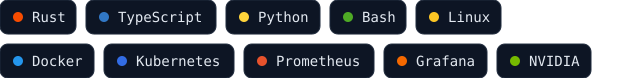

## `> about`

I work in **DCSO** (Data Center & Security Operations): keeping racks, GPU servers and the network behind them healthy, observable and locked down. I like turning repetitive ops work into small, reliable tools, and I build the pieces I can't find.

## `> what I do`

| | |
|---|---|
| **Data center ops** | server lifecycle, hardware, GPU fleets, remote access, capacity |
| **Security** | access control, hardening, auditing, post-quantum-ready transport |
| **Observability** | Prometheus, Grafana, exporters, alerting that avoids false alarms |
| **Automation** | shell, Python, Rust and TypeScript tooling that removes manual steps |

## `> projects`

<table>
<tr>
<td width="50%" valign="top">

### [JeySQL](https://github.com/Melowsdiyze/jeysql)
A schemaless JSON document database with a Rust multi-core engine, clustering with automatic failover, disk tiers, and TLS 1.3 with post-quantum key exchange.

`Rust` `TypeScript` `Raft-style cluster` `WAL`

</td>
<td width="50%" valign="top">

### [nvidia-smi-exporter](https://github.com/Melowsdiyze/nvidia-smi-exporter)
A lightweight exporter that publishes NVIDIA GPU utilisation, memory and temperature to Prometheus and Grafana.

`Shell` `Prometheus` `Grafana`

</td>
</tr>
</table>

## `> toolbox`

## `> now`

- building **JeySQL**: cluster correctness, leader fencing, disk tiers
- keeping GPU and server monitoring honest and quiet

Built with care in the data center.

